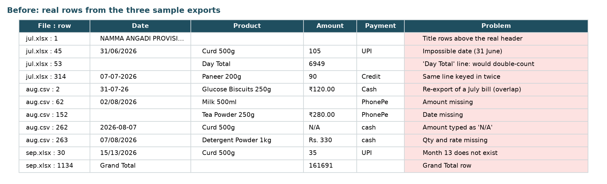
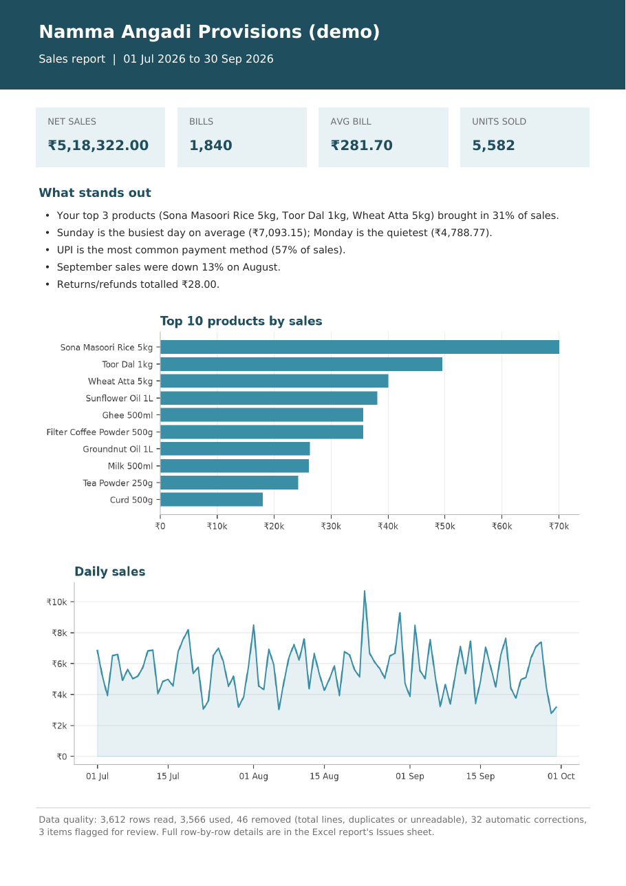
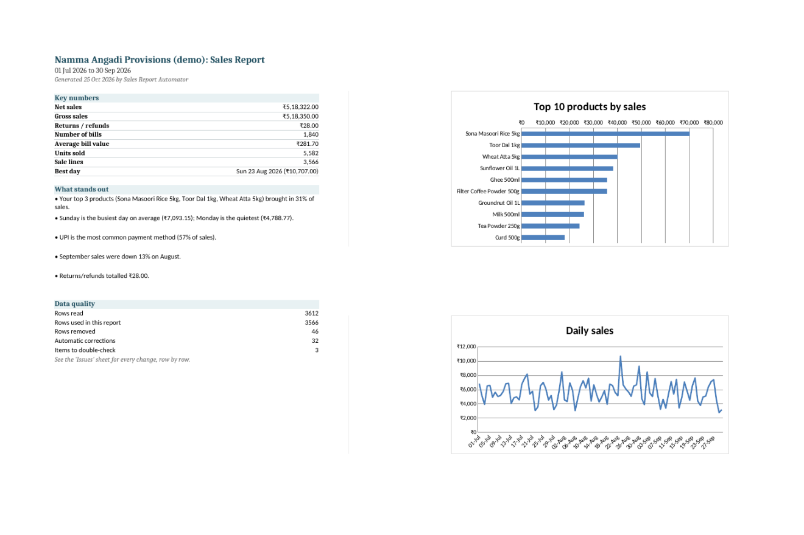
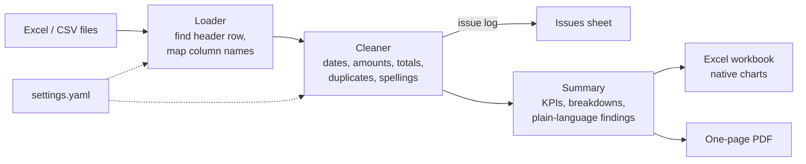

# Sales Report Automator

**Live demo:** https://sales-report-automator-tb29qzqz9fwzsj2dzymqck.streamlit.app/

**Messy sales exports in. A clean Excel report and a one-page PDF out, in seconds.**

Small shops and distributors export sales from their billing software every month, and someone spends hours fixing dates, deleting total rows, merging product spellings and building a summary by hand. This tool does that work automatically, and it shows exactly what it changed and why, so the owner can trust the numbers.

| Before: what billing exports really look like | After: the one-page PDF summary |
|---|---|
|  |  |



> All data in this repository is **fictional**, generated for a made-up store ("Namma Angadi Provisions"). No real business or customer data is used.

---

## What the business owner gets

- **An Excel workbook** with:
  - **Summary:** net sales, bills, average bill value, units sold, best day, plain-language findings, and two charts.
  - **Breakdowns:** sales by product, day, week, month and weekday, plus payment methods and categories.
  - **Clean Data:** every sale, tidied and sorted, with the original file and row number for each line.
  - **Issues:** every row that was removed, fixed or needs a second look, and why.
- **A one-page PDF** that is easy to forward on WhatsApp or print.
- **Indian formatting:** ₹ amounts with lakh grouping (₹5,18,322.00) and day-first dates.

## Messy data it handles

| Problem in the export | What the tool does |
|---|---|
| Store name and date range above the column headers | Finds the real header row automatically |
| Different column names per tool ("Bill Date", "Inv Date", "Item Name", "Particulars", "Nos", "MRP", ...) | Recognises common names; anything else goes in a small settings file |
| Dates as `05/07/2026`, `2026-07-05`, `5 Jul 2026`, `05-07-26`, or real Excel dates | Reads all of them; day-first, and ISO dates are never swapped |
| Impossible or missing dates (`31/06/2026`, `15/13/2026`) | Removes the row and says why |
| Amounts as text: `₹1,250.00`, `Rs. 90/-`, `(250)` | Converts to numbers |
| Missing amount, or missing quantity | Recalculates from quantity × rate (or amount ÷ rate) and logs it |
| Amount that doesn't match quantity × rate | Keeps the amount as entered and flags it for review |
| "Day Total", "Sub-Total", "Grand Total" lines | Removes them so sales aren't double-counted (a product called "Total Wash Detergent" is kept) |
| The same bill line twice, or months that overlap | Removes exact duplicates using the invoice number. Without invoice numbers, it only flags them, since two customers can buy the same thing. |
| `toor dal 1 KG`, `Toor Dal (1kg)`, `TOOR DAL 1KG` | Merges into one product name; real typos can be mapped in settings |
| `gpay`, `PhonePe`, `upi`, `cash` | Standardised to UPI / Cash / Card / Credit |
| Negative lines (returns) | Kept, counted as returns, and flagged |

Nothing is changed silently. On the demo data: **3,612 rows read, 3,566 used, 46 removed, 32 automatic corrections, 3 items flagged**, all listed row by row in the Issues sheet.

---

## Try it

### Option 1: Web page

```bash
pip install -r requirements.txt
streamlit run app.py
```

Open the link it prints, then upload your files or click **"Try the demo store's messy sample data"**.

### Option 2: Command line

```bash
pip install -e .
sales-report sample_data/*.xlsx sample_data/*.csv --config configs/demo_store.yaml --out output/
```

On Windows PowerShell, list the files explicitly:

```powershell
sales-report sample_data\jul_2026_sales_register.xlsx sample_data\aug_2026_sales.csv sample_data\sep_2026_sales.xlsx -c configs\demo_store.yaml -o output
```

Example output:

```
Namma Angadi Provisions (demo)  |  01 Jul 2026 to 30 Sep 2026

  Net sales              ₹5,18,322.00
  Number of bills        1,840
  Average bill value     ₹281.70
  ...
Data quality: 3,612 rows read, 3,566 used, 46 removed, 32 automatic corrections, 3 to double-check.
```

Exit codes: `0` success, `1` no usable rows, `2` bad file or settings.

---

## Setting it up for a new client

Copy `configs/demo_store.yaml` and change only what differs. Everything is optional:

```yaml
business_name: "Sri Ganesh Stores"
column_aliases:            # extra column names this client's exports use
  amount: ["Bill Value (Rs)"]
  date: ["Txn Dt"]
product_aliases:           # real typos only; case, spaces and brackets are handled already
  "Paneer 200g": ["Panner 200g"]
drop_duplicates: true
amount_tolerance: 1.0      # flag lines where amount differs from qty × rate by more than ₹1
```

If a file can't be read, the error says which columns were found and which are missing. For example: *missing required column(s): amount. Columns found: Date, Item Name, Qty.*

---

## How it works



The command line and the web page both call the same `run_report()` function, so they always produce identical results.

```
sales-report-automator/
├── app.py                      # Streamlit web page
├── configs/demo_store.yaml     # example client settings
├── sample_data/                # 3 fictional, deliberately messy exports
├── scripts/
│   ├── make_sample_data.py     # regenerates the sample files (fixed seed)
│   └── make_doc_images.py      # regenerates the README images
├── src/report_automator/
│   ├── loader.py               # read files, detect header, map columns
│   ├── parsing.py              # dates, ₹ amounts, Indian number format
│   ├── cleaner.py              # cleaning rules + issue log
│   ├── summarize.py            # KPIs, breakdowns, findings
│   ├── excel_writer.py         # formatted workbook with charts
│   ├── pdf_writer.py           # one-page PDF
│   ├── pipeline.py             # run_report(): files -> report
│   └── cli.py                  # command line
└── tests/                      # 122 tests
```

**Stack:** Python 3.10+, pandas, openpyxl, fpdf2, matplotlib, PyYAML, Streamlit. No paid APIs and no data leaves the machine (or the Streamlit session).

## Tests

```bash
pip install -e ".[dev,web]"
pytest
```

122 tests cover every cleaning rule, the date and amount parsers, header detection, error messages, the summary maths, the Excel and PDF outputs, the command line and the web page. The demo totals are also checked against a separate calculation done directly from the raw files with plain pandas (see [the case study](docs/case-study.md#how-the-numbers-were-checked)).

## Deploying a free live demo

1. Push this repository to GitHub.
2. Sign in at [share.streamlit.io](https://share.streamlit.io) with GitHub.
3. Click **Create app**, pick this repository, branch `main`, main file `app.py`, then **Deploy**.

Streamlit Community Cloud installs `requirements.txt` automatically. Uploaded files are processed in memory and are not stored.

## Known limitations

- **Sales only.** It does not do inventory, purchases or GST filing. Extra columns such as GST % are ignored and listed in "How each file was read".
- **Day-first dates.** `05/07/2026` is always 5 July. US-style month-first exports would need a settings option that doesn't exist yet.
- **One currency per report.**
- **Spelling merges are conservative.** Case, spacing and brackets are handled automatically. Real typos ("Panner") need one line in the settings file; there is no fuzzy matching, so different products are never merged by mistake.
- **Duplicates need invoice numbers.** Without them, identical lines are flagged, not removed.
- **Excel `.xls` (pre-2007) files** must be re-saved as `.xlsx`. Password-protected workbooks can't be opened.
- **Rows without a date are removed.** Some registers write the date only on the first line of each day; that style isn't filled down yet.
- Tested with exports up to a few thousand rows a month; files are limited to 25 MB.

## More

- [Case study](docs/case-study.md): the problem, approach, results, and how the numbers were verified
- [60 to 90 second demo script](docs/demo-script.md)

## License

MIT
